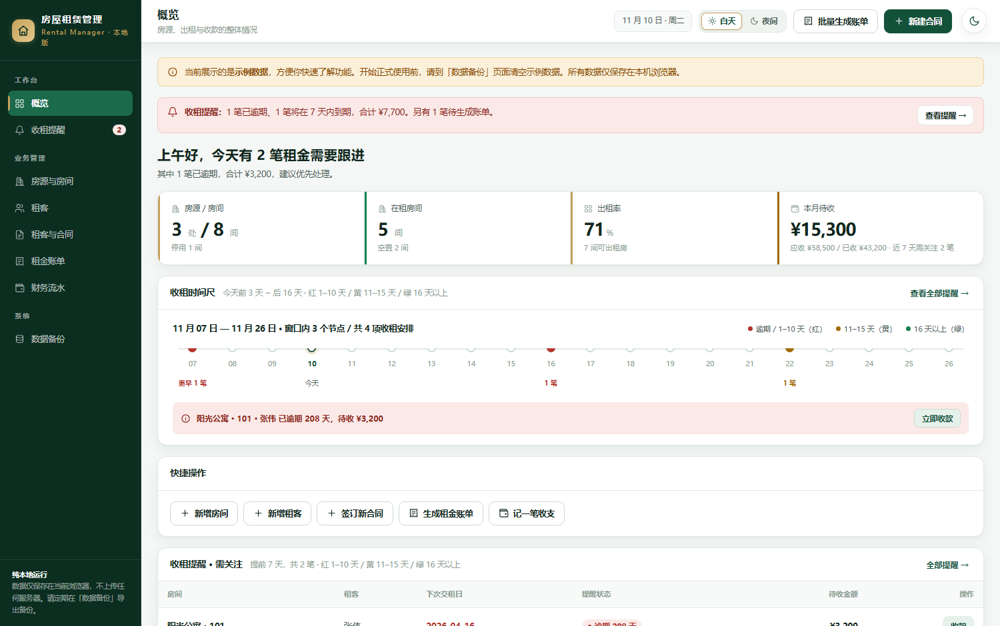
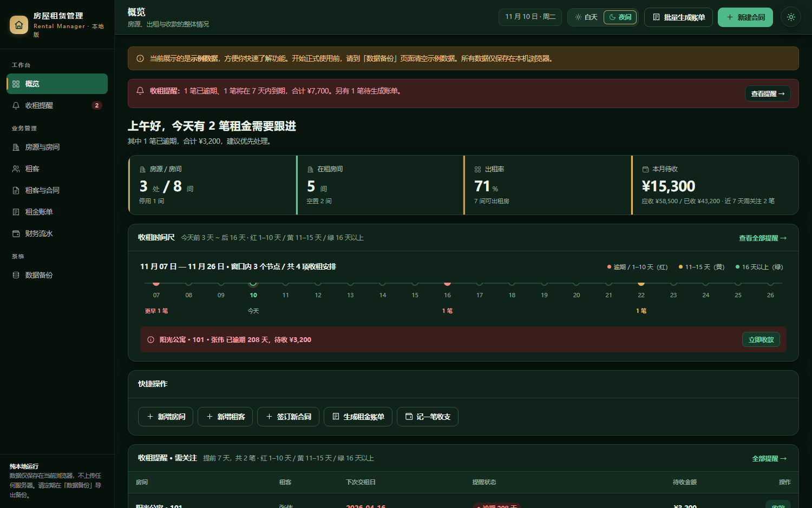

# 栖间 · NestLedger

> 把房源、租客、合同和每一期租金，安放得井井有条。
> 一套完全属于你自己的房屋租赁与收租台账：单文件可用，也可以放进 NAS 的 Docker 里长期运行。

**栖间**：栖，是安居；间，是一间房。  
**NestLedger**：Nest（家）+ Ledger（台账），也是仓库与镜像的名字。

界面设计语言「墨庭 · Quiet Estate」：深绿 `#14513A` 主色、墨绿 `#0B2E21` 侧栏、象牙白 `#F4F7F5` 内容底，香槟金 `#C6A15B` 仅用于 logo、细线、选中指示与关键强调（面积占比 < 5%）。白天 / 夜间双主题，夜间是重新校准的夜墨绿 `#08150F` / 卡片 `#10231A` / 亮绿 `#4FB98A`，**不是反色**，正文对比度均 ≥ 4.5:1。顶栏分段控件与右上角悬浮按钮都能切换，首次访问跟随系统偏好。

---

## 界面预览

| 白天 | 夜间 |
| --- | --- |
|  |  |

---

## 它解决了什么

原来这个系统是一个 `HTML` 单文件，数据只存在**当前浏览器**里：换台电脑、清一次缓存、手机上看一眼，数据就对不上了，备份也只能靠手动导出。

这个仓库在原应用之上加了一层**零依赖的本地服务端**，于是同一份代码有了两种用法：

| | 单文件模式 | NAS / Docker 模式 |
| --- | --- | --- |
| 打开方式 | 双击 `web/index.html` | 浏览器访问 `http://NAS的IP:8787` |
| 数据存放 | 浏览器 `localStorage` | 服务器 `./data/db.json` |
| 网络请求 | **零请求**（`file://` 下完全不联网） | 仅访问自己的 NAS，无外网 |
| 多设备 | 各存各的 | 手机 / 电脑 / 平板共用一份 |
| 备份 | 手动导出 JSON | 每次保存自动快照 + 一键下载 + 目录级备份 |
| 更新 | 手动替换 HTML 文件 | **网页端自动更新**（v1.3.0 起，GitHub 更新后自动升级） |
| 适用场景 | 临时离线用、随身携带 | 长期在 NAS 上使用（推荐） |

> 两种模式共用同一个 `web/index.html`。程序会自动探测：能连上同步服务就以 NAS 为准，否则安静地退回纯本地模式。

---

## 功能一览

- **房源与房间**：房源 → 房间层级，面积 / 户型 / 月租 / 押金 / 状态
- **租客与合同**：租客档案、合同起止、付款方式、本次收租时间、下次交租时间
- **合同附件**：JPG / JPEG / PNG / PDF（含用户常见的 `jepg` 拼写），单文件 ≤ 2 MB
- **租金与财务**：账单自动生成、收款、部分收款、收支流水、CSV 导出
- **收租提醒**：按「本次收租时间 + 付款方式」推算下一期；`1–10 天红`、`11–15 天黄`、`其他绿`（逾期归红、已结清灰）
- **账期口径（v1.2.1）**：账期与收租时间共用同一期次；存量合同本次收租时间跨期后，账期从收租日次月起算，不会再出现「账期 2026-09 配收租 2029-02」的错配
- **生成可见性（v1.2.2）**：生成成功后自动清除筛选并跳回账单页；筛选致空时提供「清除筛选，查看全部」一键恢复
- **版本号与自动更新（v1.3.0）**：顶栏常驻版本号，「关于与更新」里可检查 / 立即更新 / 恢复内置版本；默认自包含版从 GitHub 拉取 sha256 校验过的更新包写入 `data/app`，更新前自动快照、失败可一键回滚
- **数据备份**：完整 JSON 导入导出、NAS 自动快照、快照下载、一键备份脚本
- **界面**：深绿 × 象牙白 × 香槟金双主题、顶栏 + 右上角悬浮双入口切换、六张主表批量删除、桌面通知提醒、键盘与焦点可访问性

---

## 目录结构

```
nestledger/
├─ VERSION                       # 【版本号单一真源】改版本先改它
├─ update/
│  └─ latest.json                # 自动更新包（压缩应用代码 + sha256，由 sync-version 生成）
├─ web/
│  └─ index.html              # 整个前端（单文件，零外部资源）
├─ server/
│  ├─ index.js                # 零依赖 Node 服务端：静态托管 + 数据 API + 快照
│  └─ package.json            # 无 dependencies
├─ Dockerfile                     # 仅源码构建版使用（node:22-alpine，基础镜像可换）
├─ docker-compose.yml             # 【默认主文件】自包含版：粘贴即用、零文件依赖
├─ docker-compose.standalone.yml  # 与上面内容逐字相同的兼容副本
├─ docker-compose.build.yml       # 源码构建版（含 build，需要完整项目目录）
├─ docker-compose.image.yml       # GHCR 纯镜像版，GUI 粘贴 YAML 专用
├─ docker-compose.autoupdate.yml  # GHCR 镜像 + Watchtower，Actions 推镜像后自动重建容器
├─ .env.example                   # 配置模板（只有源码构建版会读 .env）
├─ scripts/
│  ├─ predeploy.sh            # 部署前置自检（NAS 上先跑它）
│  ├─ gen-standalone.mjs      # 重建主 compose 与兼容副本（改前端后必跑）
│  ├─ sync-version.mjs        # 版本号同步 + 重建 update/latest.json
│  ├─ test-standalone.mjs     # 真实启动验证内联包与主要接口
│  ├─ check.mjs               # 项目自检（语法 / 外链 / 配置），CI 也在跑
│  ├─ smoke.mjs               # 接口冒烟测试（本地起服务验证读写/快照/鉴权）
│  ├─ test-bills.mjs          # 账单期次与生成可见性回归测试（83 项）
│  ├─ test-update.mjs         # 自动更新链路回归（本地假更新源，54 项）
│  ├─ backup.sh               # 打包 data 目录
│  └─ restore.sh              # 从备份包恢复
├─ docs/
│  ├─ 飞牛NAS部署.md
│  ├─ 备份与恢复.md
│  └─ screenshots/            # README 用的两张界面截图
├─ .github/workflows/release.yml   # 自动构建并推送 GHCR 镜像
├─ README.md
├─ CHANGELOG.md
└─ LICENSE                    # MIT
```

容器只做两件事：托管一个网页、读写一个 JSON 文件。**没有数据库、没有 npm 包**，升级和排障都很轻。
v1.3.0 起默认自包含版会定期访问 GitHub 检查更新（可用 `UPDATE_OFF=1` 彻底关闭），业务数据始终不上传。

---

## 快速开始

### 方式 A · 双击即用（不装任何东西）

直接打开 `web/index.html`。此时是纯本地模式，数据存浏览器，零网络请求。

> 顶栏会显示当前版本号（如 `v1.3.0`）。单文件版为保证零网络请求**不提供自动更新**，升级时到 GitHub 下载最新 `web/index.html` 覆盖本文件即可。

### 方式 B · 本机 Node（不装 Docker）

需要 Node.js ≥ 18：

```bash
cd server
node index.js
# 打开 http://localhost:8787
```

数据默认写到仓库根目录的 `data/`。可用环境变量改位置：`DATA_DIR=/somewhere/data node index.js`。

### 方式 C · Docker Compose（推荐，飞牛 NAS 用这个）

默认主文件 `docker-compose.yml` **自 v1.2.0 起已是自包含版**：不含 `build`，
不读 `.env`，不需要 `Dockerfile`、`server/`、`web/` 或任何本地源码文件。

```bash
docker compose up -d
# 打开 http://localhost:8787
```

> ✅ 在飞牛 GUI 里用「粘贴 YAML」创建项目时，直接全选复制 `docker-compose.yml`
> 的整份内容粘贴即可（约 75 KB）。不要加 `--build`，也不要再找 Dockerfile。
> 如果仍报 `failed to read dockerfile`，说明项目里用的还是旧版 compose 内容，
> 用当前版本的 `docker-compose.yml` 整体替换即可。

端口 / 口令 / 快照份数直接改 YAML 里的 `ports` 与 `environment`；需要 `.env`
的请改用源码构建版 `docker-compose.build.yml`（见部署章节方式三）。

首次启动服务端没有数据，网页会把浏览器里已有的数据（或示例数据）自动迁移到 `./data/db.json`。之后所有设备访问同一地址，看到的都是这一份。

> 🔄 **v1.3.0 起，这是最后一次需要手动粘贴 YAML**：容器自带版本号与自动更新，之后在 GitHub 改代码、Actions「Build and Publish Image」跑完，网页会自己升级。详见 [更新与维护](#更新与维护)。

---

## 推到 GitHub

仓库已经初始化好（含首次提交），你只需要建一个空仓库并推上去：

```bash
cd nestledger
git remote add origin https://github.com/<你的用户名>/nestledger.git
git branch -M main
git push -u origin main
```

> 在 GitHub 新建仓库时**不要**勾选 README / .gitignore / License，保持空仓库即可。
> `data/`、`.env`、`backups/` 已在 `.gitignore` 中，业务数据不会被推上去。

推上去之后，`.github/workflows/release.yml` 会自动构建镜像发布到 `ghcr.io/<你的用户名>/nestledger`。如果 Actions 提示权限不足，到仓库 **Settings → Actions → General → Workflow permissions** 勾选 **Read and write permissions**。首次推送镜像后，若镜像是 private，在 **Packages** 里把可见性改为 Public（或在 NAS 上 `docker login ghcr.io`）。

镜像可用后，就能用 `docker-compose.image.yml` 走「零源码文件」部署，见下方方式四。

---

## 部署到飞牛 NAS（fnOS）

推荐目录：`/vol1/docker/nestledger`（卷名以你 NAS 实际为准）。

> ✅ **v1.2.0 起默认主文件 `docker-compose.yml` 已不含 `build`**。之前反复出现的
> `failed to read dockerfile: open Dockerfile: no such file or directory`，是因为
> 旧版主 compose 需要同目录的 Dockerfile，而飞牛 GUI「粘贴 YAML」创建的项目里
> 只有那段 YAML。**现在直接粘贴新版 `docker-compose.yml` 就不会再有这个错。**

**方式一：fnOS 图形界面粘贴 YAML（推荐，零文件、零 GitHub）**

1. 打开 `docker-compose.yml`，**全选复制整份内容**（约 75 KB，大部分是一行应用包）
2. 飞牛 **Docker → Compose → 新增项目 → 粘贴 YAML**，项目名 `nestledger`，启动
3. 访问 `http://<NAS 的 IP>:8787`

它把 `server/index.js` 与 `web/index.html` 压成一行 Brotli + base64 放进 `APP_BUNDLE`，
容器启动后由 `node:22-alpine` 里的 Node 自行解包再运行。**不含 `build`**，因此不需要
Dockerfile、源码文件、GitHub 或 GHCR，也从根上不会再报找不到 Dockerfile。数据仍在 `./data`。
唯一外部依赖是 `node:22-alpine` 基础镜像，国内 NAS 拉不到时见
[部署文档排障章节](docs/飞牛NAS部署.md#10-排障)。

> 兼容副本 `docker-compose.standalone.yml` 与主文件内容逐字相同，两者用哪个都行。
> 若旧项目里已经有 `data/`，新建项目前把整个 `data/` 复制到新项目目录，数据不会丢。

**方式二：终端 / SSH（后续更新最省事）**

```bash
cd /vol1/docker
git clone https://github.com/<你的用户名>/nestledger.git
cd nestledger
bash scripts/predeploy.sh       # 会识别出自包含模式并放行
docker compose up -d            # 注意：不加 --build
```

浏览器打开 `http://<NAS 的 IP>:8787`。

**方式三：源码构建版（进阶，需要完整项目目录）**

只有在你明确需要「改源码后重新 build」时才用。它含 `build`，因此
`Dockerfile`、`server/`、`web/` 必须和 compose 同层：

```bash
bash scripts/predeploy.sh . docker-compose.build.yml
cp .env.example .env             # 可选：改端口 / 口令 / BASE_IMAGE
docker compose -f docker-compose.build.yml up -d --build
```

> ⚠️ 在飞牛 GUI「粘贴 YAML」创建的空项目里不要用这一版 —— GUI 只保存 YAML，
> 不会把 `Dockerfile`、`server/`、`web/` 放进来，必然报 `failed to read dockerfile`。
> 这种情况请改用方式一。

**方式四：fnOS 图形界面（GHCR 纯镜像，需 GitHub）**

前提：已完成 GitHub 推送，GHCR 镜像可用且为 Public。

1. 复制 `docker-compose.image.yml` 全部内容（已指向 `ghcr.io/lq-wq/nestledger:latest`；fork 到其他账号时把 `lq-wq` 换成你的用户名）
2. 在飞牛 **Compose → 新增项目** 里选择「粘贴 YAML / 编辑 compose」，粘贴后启动
3. 访问 `http://<NAS 的 IP>:8787`

这个模式同样不执行 `docker build`，不需要 NAS 上有任何源码文件。已推 GitHub 的话，
它比方式一更便于长期更新（点「拉取 / 更新」即可）。

想让 Actions 推完镜像后**完全自动**重建容器，改用 `docker-compose.autoupdate.yml`（多一个 Watchtower 容器，需 NAS 允许挂载 `docker.sock`）。两条自动更新通道的区别见 [更新与维护](#更新与维护)。

> 不同 fnOS 版本的菜单名称略有差别，认准「Compose / 项目 / 堆栈」即可。
> 目录结构示意、镜像加速配置与完整排障见 [docs/飞牛NAS部署.md](docs/飞牛NAS部署.md)。

**数据卷**：`./data:/data`。所有业务数据、合同附件、自动快照都在这一个目录里，**升级容器不会动它**。建议把它放在 NAS 上有快照 / 冗余保护的共享文件夹。

---

## 数据存储与备份

```
nestledger/data/
├─ db.json          # 权威数据（含合同附件的 base64）
├─ meta.json        # 版本号 rev + 最后写入时间
└─ backups/
   └─ db-20261109-131000-r12.json   # 每次保存前的历史快照，默认保留 30 份
```

三层保险，按需取用：

1. **自动快照**：每次写入自动生成，误删一条合同也能回到上一版
2. **页面操作**：「数据备份」页 → 立即生成快照 / 刷新列表 / 直接下载任意快照；也可导出完整 JSON
3. **目录级备份**：在 NAS 上执行 `./scripts/backup.sh`，把整个 `data/` 打成 tar.gz；再配合飞牛自带的快照、外接硬盘或网盘做异地副本

恢复方式：页面「导入备份」选 JSON → 覆盖当前数据；或用 `./scripts/restore.sh <备份包>` 整目录还原。详见 [docs/备份与恢复.md](docs/备份与恢复.md)。

> 想换 NAS、换电脑、换 Docker：停掉容器，把 `data/` 整个复制到新机器的同位置，再 `docker compose up -d` 即可，无需导入导出。

---

## 更新与维护

### 网页端自动更新（v1.3.0 起，默认自包含版）

**链路**：在 GitHub 改代码并 push → `.github/workflows/release.yml` 的 **Build and Publish Image** 跑 `check.mjs` 一致性门禁、推送 GHCR 镜像、发布 `update/latest.json` → NAS 上的服务端每 6 小时（或你在网页点「检查更新」）拉取这份清单 → 校验 sha256 / 文件体积 / 版本标记 / 服务端语法 → 写入 `./data/app` 覆盖层 → 前端立即生效，服务端代码有变化才重启容器。

**网页操作**：点顶栏的版本号（如 `v1.3.0`；有新版时旁边有红点）→「关于与更新」→ **检查更新** / **更新到 vX** / 自动更新开关 / **恢复内置版本**。弹窗里能同时看到当前版本、容器内置版本、覆盖层版本、运行模式、更新来源与最近检查时间。

**安全网**：更新前自动生成一次 `data/backups/` 数据快照；旧覆盖层留一份 `previous/`；坏包（sha256 不符、体积异常、版本号不一致、服务端语法错误）一律拒绝安装且不留残留文件；服务端变化才重启，并有「10 分钟内最多 2 次」防循环保护；任何时候都能一键回滚到容器内置版本。业务数据始终在 `data/db.json`，不参与更新。

| 变量（写在主 compose 的 `environment`） | 默认 | 说明 |
| --- | --- | --- |
| `UPDATE_AUTO` | `1` | 发现新版自动应用；改 `0` 则只提示、需手动点「更新到 vX」 |
| `UPDATE_AUTO_RESTART` | `1` | 服务端代码变化后自动重启容器；改 `0` 需手动重启 |
| `UPDATE_INTERVAL` | `21600` | 自动检查间隔（秒），默认 6 小时 |
| `UPDATE_TIMEOUT` | `8000` | 单个更新源超时（毫秒） |
| `UPDATE_MANIFEST_URL` | 空 | 自定义更新清单地址。国内访问 GitHub 不稳定时填可达的镜像；配合 `UPDATE_ONLY_CUSTOM=1` 可禁止回退到 GitHub |
| `UPDATE_OFF` | `1` 表示关闭 | 彻底关闭联网检查（镜像版 / 源码构建版已默认设置） |

> 服务端默认按 **jsDelivr → raw.githubusercontent → Release asset** 多源回退；把 `UPDATE_MANIFEST_URL` 指向 Actions 发布的 `https://github.com/lq-wq/nestledger/releases/download/latest/latest.json`，还能实现「只有 CI 全部通过才更新」。
>
> ⚠️ **升级到 v1.3.0 是最后一次手动替换 YAML**：把新版 `docker-compose.yml` 整份粘贴进飞牛 Compose 项目并启动即可，`./data` 不动、数据不丢。镜像版 / 源码构建版仍由容器层或 `git pull --build` 更新，它们设了 `UPDATE_OFF=1`。

**默认自包含版（方式一 / 二）· 开发者手动重建**

改完 `web/index.html` 或 `server/index.js` 后，在本机执行：

```bash
node scripts/gen-standalone.mjs
```

它会同时重建 `docker-compose.yml` 与 `docker-compose.standalone.yml`。把新版
`docker-compose.yml` 整份重新粘贴进飞牛 Compose 项目并重启；SSH 部署则
`git pull && docker compose up -d`。`node scripts/check.mjs` 会校验内联包与源码一致，防止忘了重建。

**源码构建版（方式三）**

```bash
cd /vol1/docker/nestledger
git pull
docker compose -f docker-compose.build.yml up -d --build
```

**镜像更新（方式四）**

在飞牛 Compose 项目里点「拉取 / 更新」，或 SSH 执行：

```bash
docker compose -f docker-compose.image.yml pull
docker compose -f docker-compose.image.yml up -d
```

改动前端或服务端后，本地先跑一遍：

```bash
bash scripts/predeploy.sh          # NAS 上：部署前置自检（自动识别 compose 模式）
node scripts/check.mjs            # 语法、外链、品牌、compose 配置等静态自检
node scripts/smoke.mjs            # 起两个临时服务，验证读写 / 快照 / 鉴权
node scripts/test-standalone.mjs  # 真实启动验证内联包与主要接口
node scripts/sync-version.mjs     # 改版本号后同步四处并重建更新包
node scripts/test-bills.mjs       # 账单期次与生成可见性回归（83 项）
node scripts/test-update.mjs      # 自动更新链路回归（54 项）
```

打版本标签（`git tag v1.2.0 && git push origin v1.2.0`）会触发 Actions 生成带版本号的镜像，方便回滚到指定版本。

> 版本提示：v1.1.2 及更早版本的默认主 `docker-compose.yml` 含 `build`，在飞牛 GUI
> 粘贴时必然报 `failed to read dockerfile`。v1.2.0 起主文件改为自包含版；
> 需要源码构建请用 `docker-compose.build.yml`。
>
> **v1.2.1 升级提示**：本次修复只影响「升级后新生成」的账单。若升级前已生成过账期与收租时间错位的账单，
> 到「租金账单」→「批量生成账单」→「旧版错位账单」选 **清理（推荐）** 再确认，
> 即可删除未收款的错位账单并按新规则重建；已收 / 部分收款 / 有备注的账单不会被删。
>
> **v1.2.2**：修复「删空账单后重新生成却看不到」——生成后会自动清除筛选并跳回账单页，详见下方常见问题。

---

## 配置项

| 变量 | 默认值 | 说明 |
| --- | --- | --- |
| `PORT` | `8787` | 宿主机访问端口（容器内部固定 8787） |
| `TZ` | `Asia/Shanghai` | 时区，影响快照文件名与日期 |
| `BACKUP_KEEP` | `30` | 自动快照保留份数 |
| `BACKUP_ON_WRITE` | `1` | 每次写入是否自动快照，`0` 关闭 |
| `MAX_BODY` | `67108864` | 单次请求上限（字节），默认 64 MB |
| `AUTH_USER` / `AUTH_PASS` | 空 | 同时填写才启用 HTTP Basic 认证 |
| `BASE_IMAGE` | `node:22-alpine` | 源码构建时的基础镜像；国内 NAS 拉不到 Docker Hub 时换成可用地址 |
| `UPDATE_AUTO` | `1` | 网页端发现新版后自动应用；`0` 只提示 |
| `UPDATE_INTERVAL` | `21600` | 自动检查间隔（秒） |
| `UPDATE_MANIFEST_URL` | 空 | 自定义更新清单地址（国内网络不稳时用镜像） |
| `UPDATE_OFF` | `1` 关闭 | 彻底关闭联网检查，只改主 compose 的 `environment` |

**默认主文件 `docker-compose.yml` 不读 `.env`**：上表变量请直接改 YAML 里的
`ports`（端口）与 `environment`（TZ / BACKUP_KEEP / MAX_BODY / AUTH_USER 等）。
只有源码构建版 `docker-compose.build.yml` 会读 `.env`，改完执行
`docker compose -f docker-compose.build.yml up -d`（改 `BASE_IMAGE` 需加 `--build`）。
纯镜像版 `docker-compose.image.yml` 同样不读 `.env`。

---

## 安全建议

- 默认**不带认证**，请只在家庭局域网 / VPN 内使用；不要把 8787 端口直接映射到公网
- 确需外网访问时：填 `AUTH_USER` / `AUTH_PASS`，并建议再套一层 NAS 的反向代理 + HTTPS
- 数据包含租客姓名、电话、身份证号与合同扫描件，属于敏感个人信息；`data/` 不要放进公开仓库、不要同步到公共网盘
- 容器默认以 root 运行，是为了兼容不同 NAS 对 `./data` 目录的属主差异；如果 NAS 上权限收紧，可在 compose 里增加 `user: "1000:1000"` 并提前 `chown -R 1000:1000 ./data`

---

## 常见问题

**Q：部署报 `failed to read dockerfile: open Dockerfile: no such file or directory`？**  
说明项目里用的 compose 还带 `build:`，而构建上下文中没有 `Dockerfile` —— 飞牛 GUI
「粘贴 YAML」创建的空项目必然如此，这个错**不可能靠修 Dockerfile 解决**。
**最快解：升级到 v1.2.0，把新版 `docker-compose.yml`（默认主文件，已不含 `build`）
全文重新粘贴进 Compose 项目**，零文件即可运行。若确实需要源码构建，改用
`docker-compose.build.yml` 并跑 `bash scripts/predeploy.sh . docker-compose.build.yml`
按提示补齐源码目录。详见 [部署文档排障章节](docs/飞牛NAS部署.md#10-排障)。

**Q：日志里 `nestledger Pulling` 和 `registry-1.docker.io context deadline exceeded`？**  
v1.1.0 及更早版本的 compose 同时写了 `image:` 与 `build:`，Compose 会先去 Docker Hub
找同名镜像；v1.2.0 的主文件已完全不含这两项。若卡在拉 `node:22-alpine` 基础镜像，
在「飞牛 Docker → 设置 → 镜像加速」配置加速器，或直接把 YAML 里 `image:` 一行换成
NAS 能拉到的地址；源码构建版则在 `.env` 设置 `BASE_IMAGE`。

**Q：打开后显示的还是旧数据？**  
NAS 上的 `data/db.json` 是权威副本，首次连接会以它为准。想用旧浏览器里的数据，先在旧页面「导出完整数据（JSON）」，再到 NAS 页面「导入备份」。

**Q：手机和电脑数据不一致？**  
切回页面或等待 20 秒会自动拉取最新版；顶栏状态显示「已保存到 NAS」即已同步。两端同时编辑时，以最后一次保存为准。

**Q：顶栏显示「待同步（离线）」？**  
数据已暂存浏览器，网络恢复后会自动重试写入；期间请勿清理浏览器数据。

**Q：端口被占用？**  
默认主文件 `docker-compose.yml` 不读 `.env` —— 直接把 YAML 里 `ports` 的
`"8787:8787"` 改成比如 `"8877:8787"`，再 `docker compose up -d`。源码构建版改 `.env` 的 `PORT`。

**Q：合同附件能传多大？**  
单文件 ≤ 2 MB；NAS 模式总容量比纯本地模式宽松得多（默认上限 64 MB，
在默认主文件 YAML 的 `environment.MAX_BODY` 调；源码构建版用 `.env` 的 `MAX_BODY`）。

**Q：想改项目名？**  
改 `web/index.html` 里的 `APP_NAME` / `APP_NAME_EN`、`<title>`、侧栏品牌区，
改完记得执行 `node scripts/gen-standalone.mjs` 重建主 compose；容器名在 `docker-compose.yml` 里改。

**Q：升级到 v1.2.1 后，以前生成的账单账期和收租时间还是错位的？**  
正常，升级不会改写历史账单。到「租金账单」→「批量生成账单」，弹窗会显示检测到几笔错位账单，
把「旧版错位账单」保持 **清理（推荐）** 再确认即可：删除未收款、无备注的错位账单并按新规则重建，
已收 / 部分收款 / 有备注 / 手工编辑过的账单一律保留。想逐条处理就选「保留」后手动删除。
详见 `docs/飞牛NAS部署.md` 第 8 节。

**Q：提示「已生成账单」，但租金账单页看不到？**  
v1.2.1 及更早版本会保留账单页的筛选状态：删空账单后原先选中的月份从下拉里消失，界面显示「全部月份」而内部筛选值仍在，新账单就被静默过滤了；新账期从收租日次月起算，筛选「当月」同样看不到。
**v1.2.2 起，生成成功后会自动清除筛选并跳回账单页**。若升级前已经生成过：进「租金账单」页点 **清除筛选，查看全部**，
或再点一次「批量生成账单」（不会重复生成）即可看到。
另外，合同「本次租金」标为 **已收讫** 时本期不生成待收账单，会从下一期开始；需要连本期一起生成就把「本次租金」改为 **待收**。

**Q：怎么知道当前跑的是哪个版本？想手动升级怎么办？**  
看顶栏右上角的版本号按钮（如 `v1.3.0`）。点开「关于与更新」能看到当前版本、内置版本、覆盖层版本与更新来源；点 **检查更新**，有新版时按钮会变成 **更新到 vX**。有新版时版本号旁边会出现红点。单文件本地版（`file://`）只显示版本号，不联网、不自动更新。

**Q：一直提示「更新检查未成功」，影响使用吗？**  
不影响，业务功能与数据完全照常。常见原因是 NAS 访问 GitHub 超时。可在主 compose 的 `environment` 加 `UPDATE_MANIFEST_URL` 指向国内可达的更新清单镜像；或设 `UPDATE_AUTO: 0` 只手动检查，甚至 `UPDATE_OFF: 1` 彻底关闭。检查失败不会写入任何文件。

**Q：自动更新会不会覆盖我的房源 / 账单数据？**  
不会。更新只写 `data/app` 里的 `web/index.html` 与 `server/index.js`，业务数据始终在 `data/db.json`；更新前还会额外生成一次 `data/backups/` 快照。若更新后界面异常，点「关于与更新」→ **恢复内置版本** 即可回到容器自带版本，数据不受影响。

**Q：用 GHCR 镜像部署，为什么「关于与更新」说由容器管理版本？**  
镜像版的版本号跟镜像走，网页端自动更新会与镜像版本打架，所以 `docker-compose.image.yml` / `docker-compose.autoupdate.yml` / `docker-compose.build.yml` 都设了 `UPDATE_OFF: 1`。Actions 推完新镜像后，在飞牛 Compose 点「拉取 / 更新」，或用 `docker-compose.autoupdate.yml` 里的 Watchtower 自动重建容器即可。

---

## License

[MIT](LICENSE) · 前端为单文件原生 HTML/CSS/JS，服务端只用 Node 内置模块，无任何第三方运行时依赖。
